# Zapier Integration Preview — Property Sales Automation

A focused, interactive preview of the **Zapier side** of the lot-sales integration for **Pacific Horizon Developments** (Harbour View Residences, Port Vila, Vanuatu). It contains only two screens:

- **Zaps:** a Zap-editor style view of every Zap, with triggers, actions, field mappings, filters and test results.
- **Zap history:** every run, with status, error details and retry.

Process Street, HubSpot, Google Drive and Xero appear only as the apps that the Zaps connect to. They have no screens of their own in this branch. The full multi-app demo is on `claude/high-fidelity-product-ui`.

> **DEMO ENVIRONMENT · SYNTHETIC DATA · SIMULATED INTEGRATIONS**
> All people, records, amounts and documents are fictional. No vendor APIs are called and no credentials are needed. The screens are original components that recreate familiar UI patterns. They are not Zapier's software, use no vendor logos, and imply no affiliation or endorsement.

## Run it

```bash
npm install
npm run dev        # or: npm run build && npm run preview
```

The demo bar at the top has two controls:
- **Outage:** simulates an API outage, so the next Zap run errors.
- **Reset:** returns LOT-025 to the start.

## The Zaps

| Zap | Trigger → actions | Business purpose |
|---|---|---|
| **Overview** | Process Street → HubSpot → Contract → Drive → Xero | The whole flow on one canvas. **Run next stage** advances LOT-025 one Zap at a time. |
| **Zap 1** | Process Street task checked → find/create HubSpot contact → find/create deal | Buyer and deal are matched on Buyer ID or email and `deal_key` (Lot ID + Buyer ID), so no duplicates are created. |
| **Zap 2A** | HubSpot deal at Contract Approval → generate contract from template → find/create Drive folder → upload draft and supporting documents | Contract generation and the transaction folder. |
| **Zap 2B** | Internal approval → save approved PDF → send for e-signature | Review before the buyer sees the contract. |
| **Zap 2C** | Buyer signs → save signed contract → deal → Closed Won | Signature closes the deal. |
| **Zap 3** | Deal Closed Won → **Filter** (business rules) → find/create Xero contact → create **draft** invoice | Xero is touched only when every rule passes. |
| **Zap 4 / 5** | Xero payment → HubSpot; settlement | Supporting Zaps. |
| **Zap 6** | Supplier invoice in a shared inbox → Xero draft bill | Later phase. |

**Zap 3 filter rules:** deal is Closed Won · contract approved internally · contract signed by buyer · Buyer ID present · Lot ID present · amount > 0 · currency VUV · no existing invoice.

**Why Zap 3 uses Zapier rather than HubSpot's native Xero app:** HubSpot's Xero data sync does not support VUV and does not sync draft invoices ([HubSpot Knowledge Base](https://knowledge.hubspot.com/integrations/connect-hubspot-and-xero-data-sync)).

## UI previews

Screenshots show synthetic data at 1440 × 900, captured from the running app.

### End-to-end overview
| Before any run | After Zap 1 |
|---|---|
| 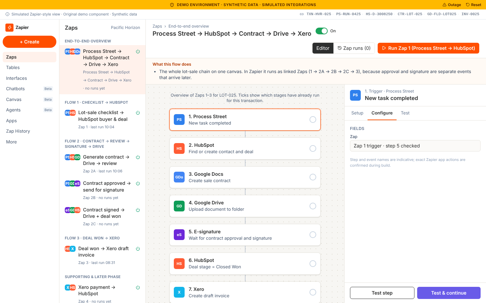 | 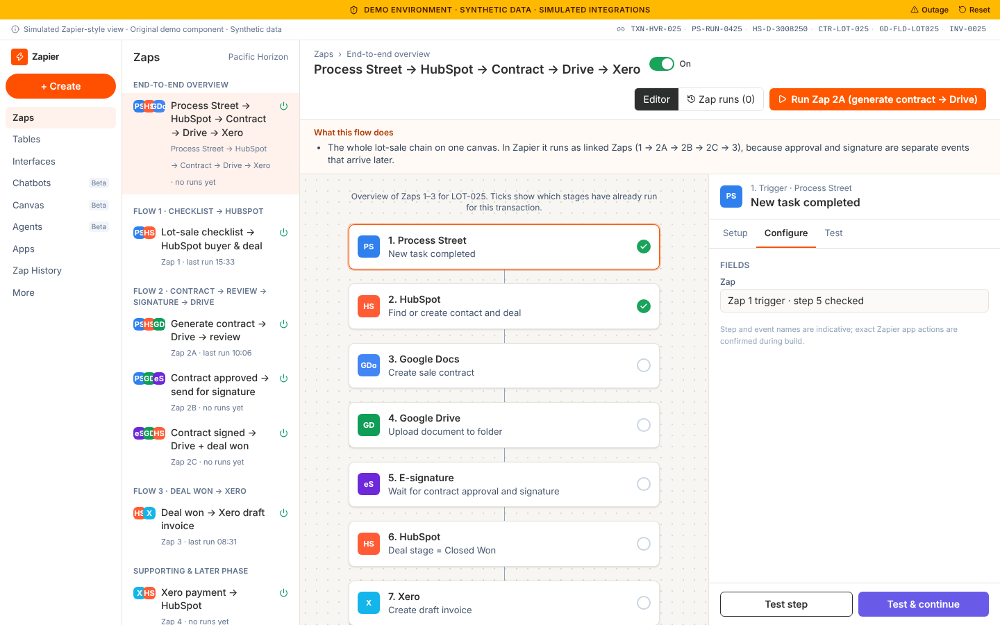 |

| All stages complete (draft invoice INV-0025) |
|---|
| 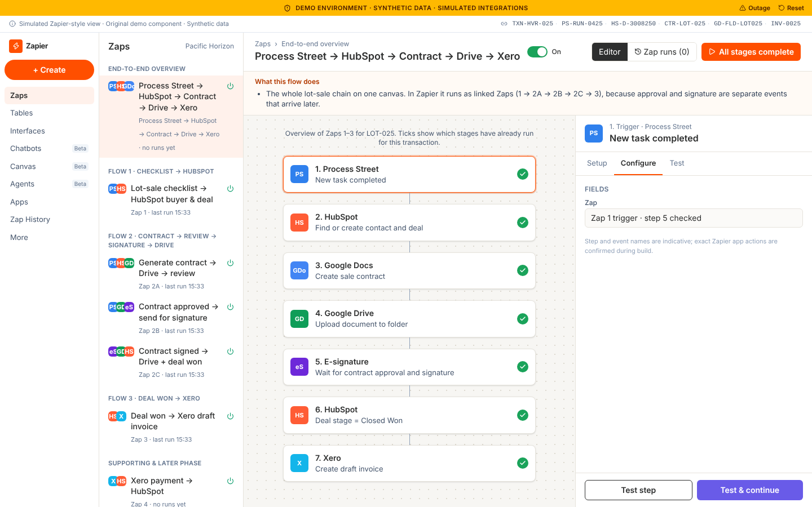 |

### Zap editor
| Zap 1 field mapping | Zap 1 test successful |
|---|---|
| 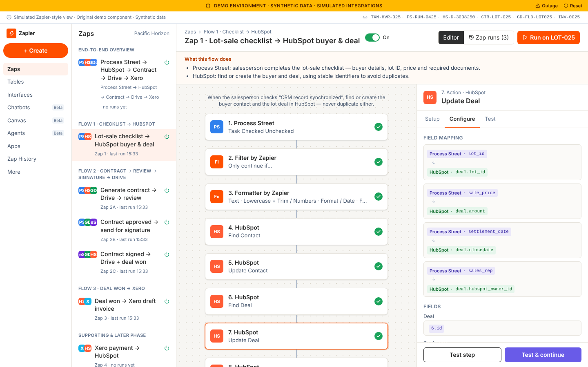 | 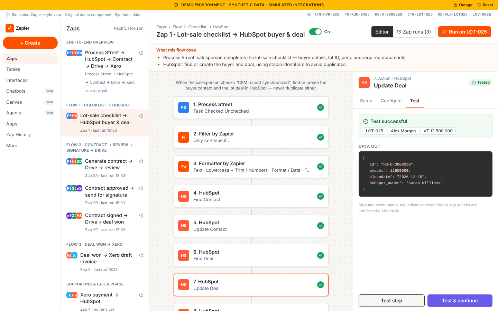 |

| Zap 3 business rules (filter) | Zap 3 runs |
|---|---|
| 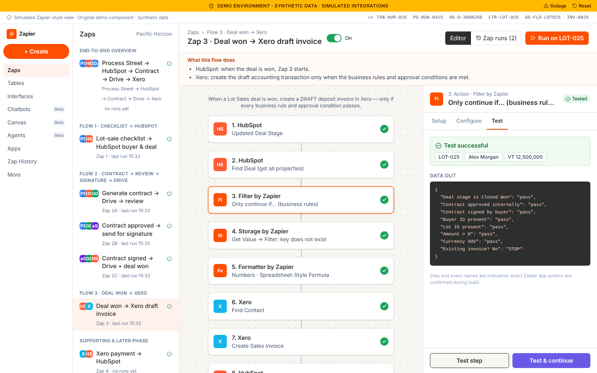 | 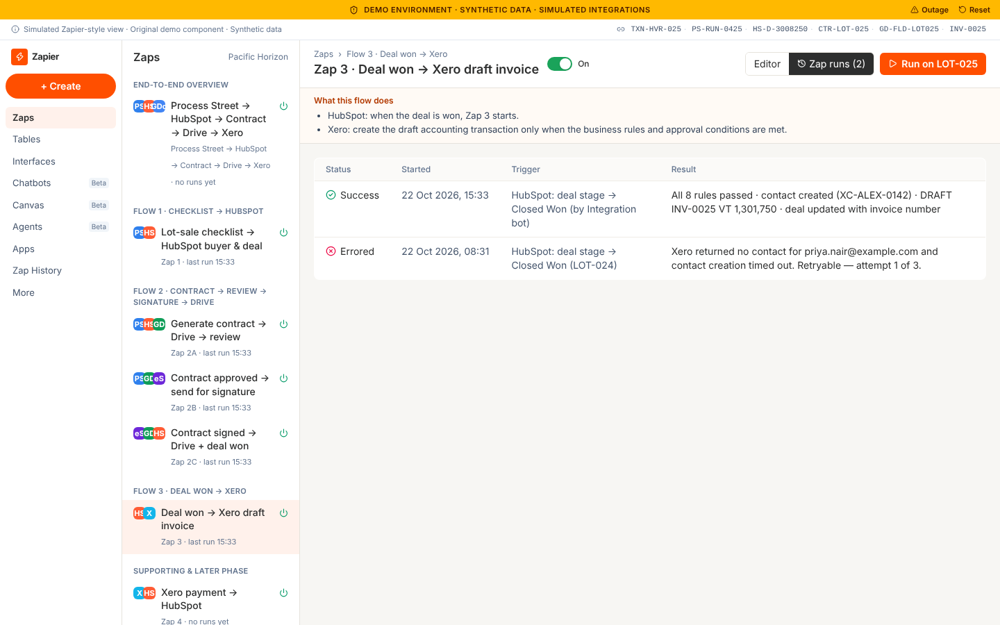 |

| Zap 2A contract → Drive |
|---|
| 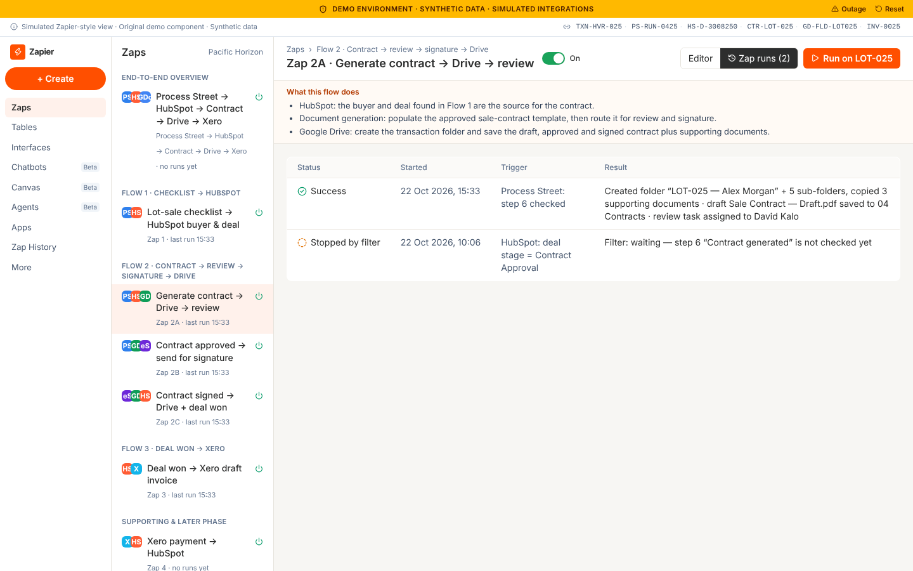 |

### Zap history
| All runs | Errored run (retryable) |
|---|---|
| 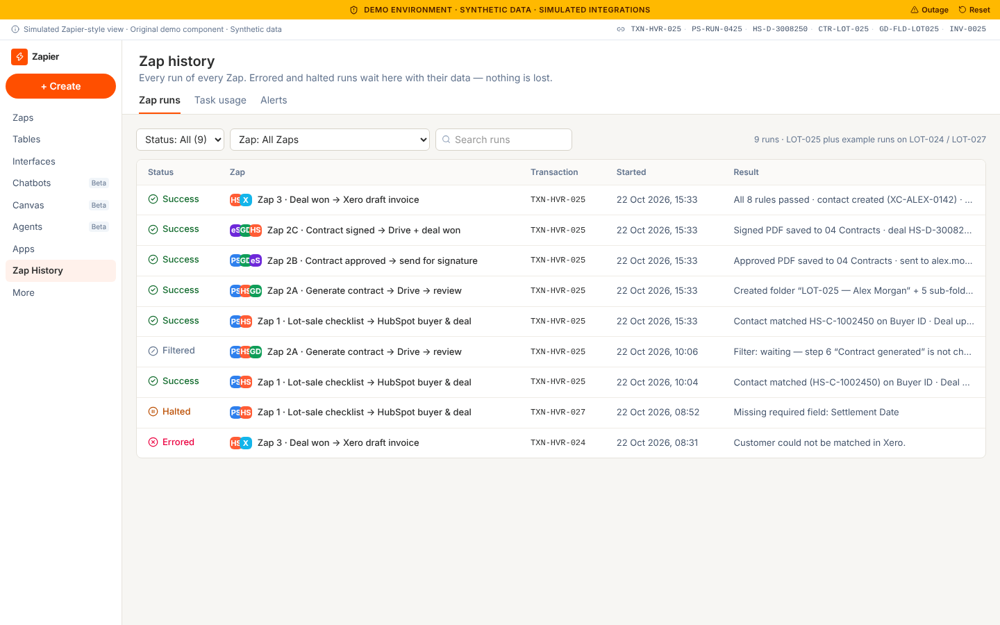 | 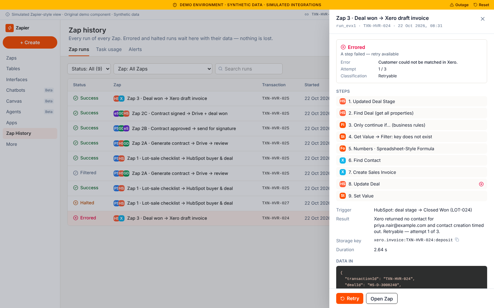 |

| Halted run (validation, fix before retry) | After retry |
|---|---|
| 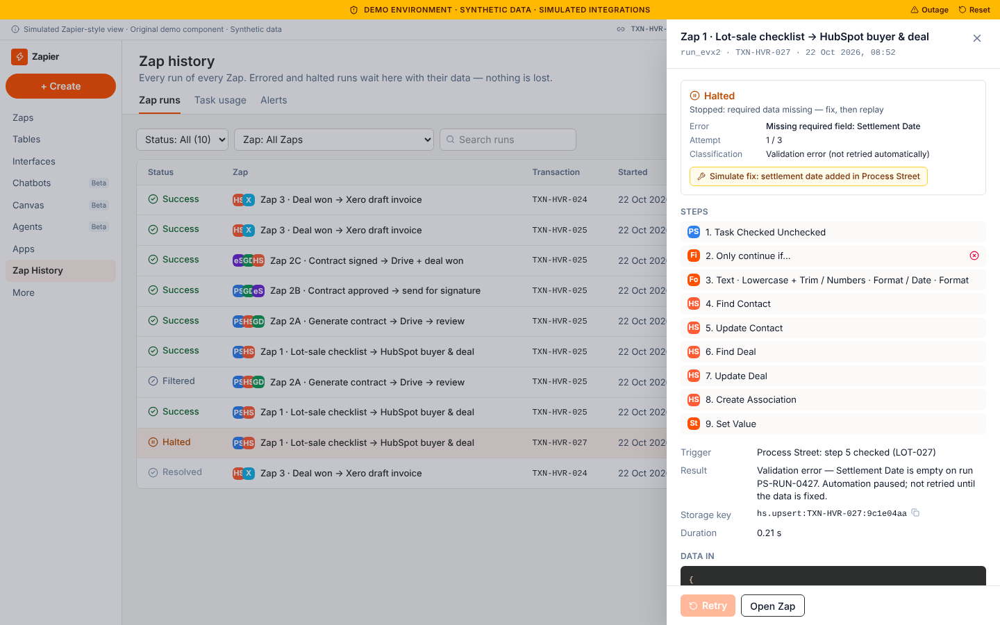 | 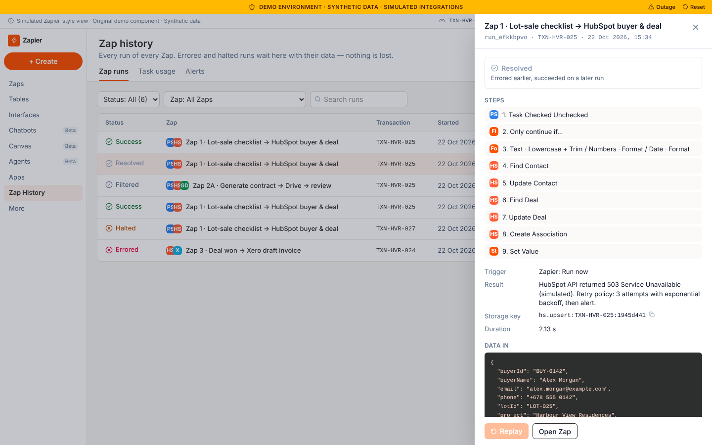 |

## Walkthrough (about 5 minutes)

1. Open **Zaps → Overview** and click **Run next stage** four times. This runs Zap 1, Zap 2A, then Zap 2B (approve), then Zap 2C with Zap 3 (buyer signs). LOT-025 ends with a **draft** Xero invoice, INV-0025.
2. Open **Zap 1** and click a step to show **Setup / Configure / Test**, the mapping pills and the successful test record.
3. Open **Zap 3** and show the filter. Before signature it stops the run, so Xero is untouched.
4. Open **Zap history**:
   - The **errored** LOT-024 run is a retryable Xero error: click **Retry**.
   - The **halted** LOT-027 run is missing its settlement date: retry is disabled until **Simulate fix** is clicked.
5. Click **Reset**, turn on **Outage**, and run Zap 1. It errors. Turn the outage off and retry it from Zap history.

## Duplicate protection

Each Zap checks, and then writes, a key in **Storage by Zapier** before it creates anything:

| Zap | Key |
|---|---|
| 1 | `hs.upsert:TXN-HVR-025:<payload hash>` |
| 2A / 2B / 2C | `contract.generate:…`, `contract.approve:…`, `contract.signed:TXN-HVR-025:v1` |
| 3 | `xero.invoice:TXN-HVR-025:deposit` |
| 6 | `xero.bill:<supplier id>:<invoice number>` |

Repeated runs are shown as duplicates and skipped. Failed runs never record their key, so a retry runs normally.

## Record IDs

| Record | ID |
|---|---|
| Transaction | `TXN-HVR-025` |
| Process Street run | `PS-RUN-0425` |
| HubSpot contact / deal | `HS-C-1002450` / `HS-D-3008250` |
| Sale contract | `CTR-LOT-025` |
| Google Drive folder | `GD-FLD-LOT025` |
| Xero contact / invoice | `XC-ALEX-0142` / `INV-0025` |

## Project structure

```
src/
  data/        types, seed data, Zap definitions
  store/       engine.ts (pure, idempotent flow engine) · DemoStore.tsx (localStorage state)
  components/  app shell with demo bar, product frame, UI primitives, toasts
  pages/       Zaps.tsx (editor + overview) · ZapHistory.tsx (runs, errors, retry)
```

Stack: React 19, TypeScript, Vite, Tailwind CSS v4, React Router and Lucide icons. Demo state is kept only in the browser's `localStorage`.
